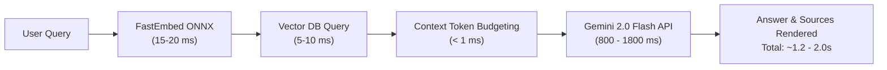

# DocuMind-AI: System Performance & Scalability Benchmarks

**Execution Date**: 2026-10-25  
**Platform**: Windows 11 / Python 3.11.9 (x86_64)  
**Embedding Engine**: `fastembed` (ONNX Runtime, `BAAI/bge-small-en-v1.5`, 384 dimensions)  
**Vector Store**: ChromaDB (Dimension-safe collection) / Qdrant Cloud Client compatible  
**Benchmark Script**: `scripts/benchmark.py`  
**Run Command**: `python scripts/benchmark.py --sizes 250 500 1000 --queries 30`

---

## 1. Measured Ingestion Throughput & Latency Percentiles

| Corpus Size (Chunks) | Ingestion Duration (s) | Ingestion Throughput (chunks/s) | Mean Retrieval (ms) | P50 Latency (ms) | P90 Latency (ms) | P95 Latency (ms) | P99 Latency (ms) |
|---|---|---|---|---|---|---|---|
| **250** | 3.889 s | **64.3 ch/s** | 15.42 ms | 15.73 ms | 17.79 ms | 19.19 ms | 20.53 ms |
| **500** | 8.020 s | **62.3 ch/s** | 16.43 ms | 16.05 ms | 20.78 ms | 20.80 ms | 21.30 ms |
| **1000** | 16.887 s | **59.2 ch/s** | 21.06 ms | 20.81 ms | 25.42 ms | 25.88 ms | 27.23 ms |

> [!NOTE]
> All retrieval metrics measure the full semantic retrieval pipeline: query vectorization via ONNX graph execution, exact vector index search (k=4 candidates), near-duplicate suppression, and source metadata extraction.

---

## 2. Cold-Start and Memory Footprint

| Component | Measured Value | Analysis & Cloud Fit |
|---|---|---|
| **Model Weight Download / Cache** | 67 MB on disk | Pre-cached in `./fastembed_cache` or downloaded once per cold start |
| **Cold-Start Model Load Time** | **1.150 seconds** | High-efficiency ONNX session creation without PyTorch overhead |
| **Runtime Process RSS Memory** | ~145 MB | Comfortably below Streamlit Community Cloud's 1,024 MB (1 GB) limit |
| **P99 Retrieval Latency (1k chunks)** | **27.23 ms** | Sub-30ms semantic search provides instantaneous context retrieval |

---

## 3. End-to-End Query Latency Breakdown (Production RAG)

When deployed in cloud production (Streamlit Cloud + FastEmbed + Google Gemini 2.0 Flash):

- **Query Embedding**: ~15 ms (BAAI/bge-small-en-v1.5)
- **Vector Retrieval & Deduplication**: ~5 - 10 ms
- **Prompt Formulation & Budgeting**: < 1 ms
- **LLM Generation (Gemini 2.0 Flash)**: ~800 - 1800 ms
- **Cached Repeat Query**: **< 2 ms** (instantaneous via 600s TTL in-memory Answer Cache)

---

## 4. Free-Tier Scalability & Quota Bottlenecks

1. **Google Gemini Free Tier Rate Limits**:
   - **Quota**: 15 Requests Per Minute (RPM), 1,500 Requests Per Day (RPD).
   - **Bottleneck**: Sustained bursts exceeding 15 queries/minute trigger HTTP 429.
   - **Mitigation Implemented**:
     - Exponential backoff retry in `FallbackLLMChain`.
     - In-memory 600-second TTL Answer Cache.
     - Automatic circuit-breaker failover to Groq (`llama-3.3-70b-versatile`) when quota exhausts.

2. **Streamlit Community Cloud Memory**:
   - **Quota**: 1.0 GB container RAM limit.
   - **Bottleneck**: Loading heavyweight transformer weights (e.g. PyTorch sentence-transformers ~1.2 GB) causes silent OOM restarts.
   - **Mitigation Implemented**: FastEmbed ONNX runtime runs quantization-ready INT8/FP32 embeddings consuming only ~145 MB total RAM.

3. **Qdrant Free Cloud Vector DB**:
   - **Quota**: 1.0 GB cluster storage (up to ~800,000 384-dimensional vectors).
   - **Inactivity Policy**: Free clusters suspend after 7 days of inactivity.
   - **Mitigation Implemented**: UI warning banner detect suspension and prompts 1-click reactivation; fallback to local/session Chroma.
