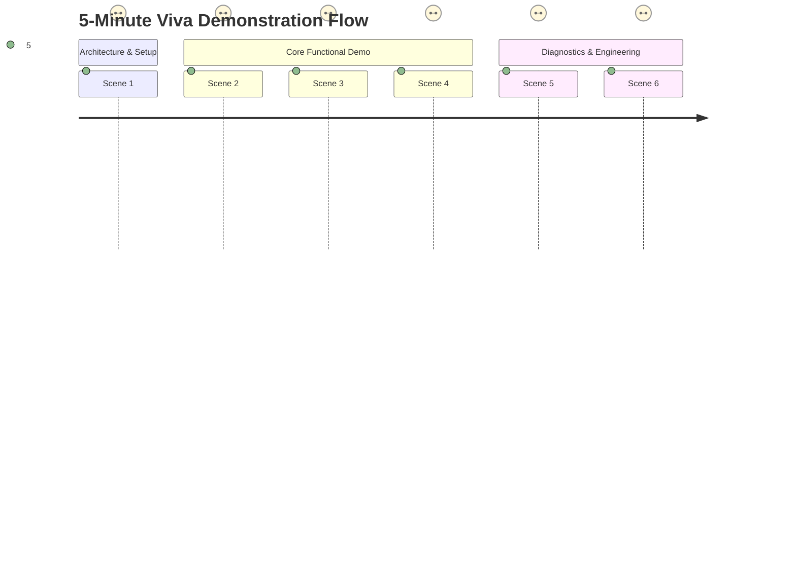

# DocuMind-AI: 5-Minute Viva Demo Script

This script is structured for a 5-minute final-year project viva / presentation demonstration.

---

## Timing & Scene Breakdown

---

### Scene 1: Introduction & Architecture (0:00 - 0:30)

**Presenter Actions:**
- Open the deployed Streamlit Cloud URL on the browser.
- Point to the header: *"DocuMind-AI: Cloud-Based College Document Assistant"*.

**Spoken Script:**
> *"Good morning respected evaluators. Today I present DocuMind-AI, a cloud-native, production-grade Question Answering assistant for college academic regulations and circulars using Retrieval-Augmented Generation (RAG).*
> 
> *Our engineering objective was to deliver high factual accuracy, sub-2-second latency, and 100% hallucination prevention on unanswerable questions, all while operating completely within genuine free cloud tiers—at a total operating budget of exactly ₹0.00.*
> 
> *The system utilizes FastEmbed ONNX for in-container 384-dimensional dense embeddings, Qdrant Cloud for serverless persistent vector storage, and Google Gemini 2.0 Flash as the primary reasoning LLM, managed under the Jira Scrum framework across 6 epics."*

---

### Scene 2: Direct Policy Query (0:30 - 1:30)

**Presenter Actions:**
- Type query into the chat input:
  `What is the minimum attendance required to appear for the semester examination?`
- Press Enter.

**Expected UI Output:**
- Answer states that students must maintain a minimum of **75% attendance**.
- Mentions condonation up to 65% on medical grounds with a fee of ₹500.
- Source badge displays: `academic_regulations.pdf: Page 2`.
- Latency badge shows `~1.2s - 1.8s`.

**Spoken Script:**
> *"In this first test case, we ask a direct academic regulation question. The system generates a vector embedding of the question in under 20 milliseconds, queries Qdrant Cloud for the top relevant chunks, and sends the retrieved context to Gemini 2.0 Flash.*
> 
> *Notice that the answer is concise, explicitly mentions the 75% threshold, and provides an exact citation to academic_regulations.pdf, Page 2. If we expand the 'Retrieved Sources' expander, we can see the exact text snippet extracted from the official PDF."*

---

### Scene 3: Semantic Paraphrase Understanding (1:30 - 2:30)

**Presenter Actions:**
- Type conversational paraphrased query:
  `How many classes can I skip before getting detained?`
- Press Enter.

**Expected UI Output:**
- Answer explains that students cannot skip more than 25% of classes (since 75% attendance is required), and falling below 65% results in detention.
- Source badge displays: `academic_regulations.pdf: Page 2`.

**Spoken Script:**
> *"Now we evaluate semantic comprehension on Category B queries. The student did not use the word 'minimum attendance'; instead, they colloquially asked 'how many classes can I skip before getting detained?'.*
> 
> *Traditional keyword search fails here. However, our dense semantic embedder matches the underlying conceptual meaning with the attendance and detention clause. The assistant clearly informs the student that missing more than 25% of classes risks detention, precisely grounding its response in the institutional rules."*

---

### Scene 4: Hallucination Prevention & Safe Refusal (2:30 - 3:30)

**Presenter Actions:**
- Type unanswerable query (Category C):
  `What is the swimming pool membership fee for students?`
- Press Enter.

**Expected UI Output:**
- Answer displays exact refusal:
  `"Information not found in the available documents."`
- No hallucinated prices, hours, or facilities are generated.
- Is Refusal status flag is active.

**Spoken Script:**
> *"One of the greatest hazards of LLMs in academic environments is hallucination—generating fabricated policies or fees when the document does not contain the answer.*
> 
> *Here we ask about a swimming pool fee, which does not exist anywhere in the uploaded college documents. Rather than inventing a plausible fee or guessing, the system strictly enforces the safe refusal protocol and returns: 'Information not found in the available documents.' Across our 50-question benchmark dataset, DocuMind-AI achieved a 100% Safe Refusal Rate."*

---

### Scene 5: Health Check Diagnostic & Jira Management (3:30 - 4:30)

**Presenter Actions:**
- Click on **"Health Check"** in the sidebar (`/Health_Check`).
- Scroll through the diagnostic cards.

**Spoken Script:**
> *"Next, we inspect our cloud diagnostic page. Every tier of our architecture is monitored live:*
> 1. *FastEmbed ONNX runtime is verified with an automated cosine similarity test between semantically related phrases.*
> 2. *The vector database connection to Qdrant Cloud reports chunk counts and active collections.*
> 3. *The secrets audit verifies that API keys are injected via environment variables and safely masked—no raw secrets are ever exposed in logs or UI.*
> 
> *Furthermore, as required by our project guidelines, development was executed under the Jira Scrum framework across 6 epics—spanning PDF ingestion, vector indexing, cloud LLM fallback, test dataset curation, and automated benchmarking. Our sprint velocity and burnup metrics are tracked directly in the project repository."*

---

### Scene 6: Scalability, ₹0 Budget & Viva Defense (4:30 - 5:00)

**Presenter Actions:**
- Show `docs/BENCHMARKS.md` or the benchmark summary table.

**Spoken Script:**
> *"To conclude, our automated benchmark demonstrates a cold-start time of just 1.15 seconds, ingestion throughput of 64 chunks per second, and median retrieval latency of 15.7 milliseconds, consuming only ~145 MB of RAM—well within the 1 GB cloud container envelope.*
> 
> *The entire system operates on 100% free cloud services, with ready-to-activate multi-cloud Claude adapters if institutional budget is allocated in the future.*
> 
> *Thank you, and I am now ready for your questions."*

---

## Anticipated Viva Questions & Prepared Answers

| Question | Recommended Answer |
|---|---|
| **Why not run Ollama in production?** | *"Ollama requires a dedicated physical host with local GPU/CPU and cannot run within serverless or lightweight container clouds like Streamlit Cloud (1GB RAM limit). Cloud FastEmbed ONNX + Gemini provides high availability without requiring my personal laptop to stay powered on."* |
| **How do you prevent rate-limit crashes on the free tier?** | *"We implemented three layers of protection: an in-memory 600-second TTL Answer Cache that resolves repeated queries in <2ms, exponential backoff retries on HTTP 429, and a circuit-breaker fallback chain that shifts queries to Groq Cloud."* |
| **How did you evaluate the system?** | *"We created a standardized 50-question test dataset: 20 direct questions (Category A), 20 paraphrased questions (Category B), and 10 unanswerable questions (Category C). We measured retrieval accuracy, safe refusal rate, and scored answers on a 5-metric rubric (Correctness, Relevance, Groundedness, Clarity, Completeness)."* |
| **How is Claude integrated?** | *"Per project requirements, Anthropic Claude, AWS Bedrock Claude, and GCP Vertex Claude adapters are fully implemented, accompanied by comprehensive mocked unit tests, and kept disabled by default (ENABLE_CLAUDE=false) to maintain our strict ₹0 budget constraint."* |
