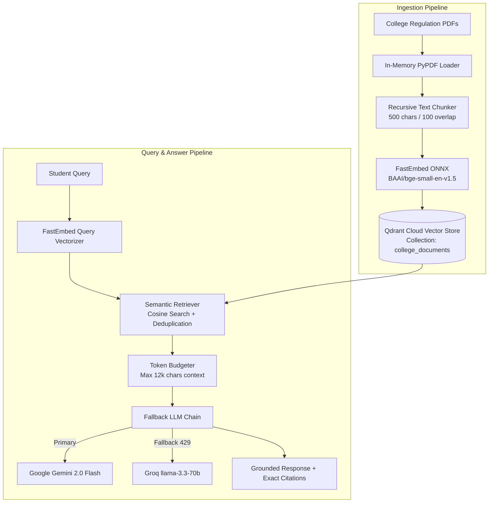

# Academic Project Report Draft

## TITLE: Design and Development of a Cloud-Native, Scalable College Document Question-Answering Assistant Using Retrieval-Augmented Generation (RAG)

**Course**: Final Year Engineering Mini-Project / Cloud Computing Lab (Problem 3)  
**Project Repository**: `https://github.com/co2023smniyazi/DocuMind-AI`  
**Active Branch**: `cloud-scalable-rag`  
**Project Management**: Jira Scrum Framework  
**Operating Budget**: ₹0.00 (Zero Cost, 100% Free Cloud Tiers)  
**Deployment Status**: Not Deployed (Codebase ready for Streamlit Cloud deployment)  

---

## Abstract

Academic institutions issue voluminous administrative handbooks, academic regulations, examination ordinances, syllabus documents, and operational circulars. Students and faculty frequently struggle to locate precise procedural information in a timely manner. Conventional keyword search mechanisms fail when queries use colloquial paraphrasing, while generic Large Language Models (LLMs) suffer from domain ignorance and hallucinations. 

This project presents **DocuMind-AI**, a cloud-native Question-Answering system based on **Retrieval-Augmented Generation (RAG)**. Originally prototyped using local workstation dependencies (Ollama), the system was re-architected for genuine zero-cost cloud deployment. The architecture integrates **FastEmbed ONNX** (`BAAI/bge-small-en-v1.5`, 384 dimensions) for high-speed in-container vectorization, **Qdrant Cloud Free Tier** for persistent serverless vector storage, and **Google Gemini 2.0 Flash** via the official `google-genai` SDK as the primary reasoning engine, with automated fallback to **Groq Cloud** (`llama-3.3-70b-versatile`). 

Development followed the **Jira Scrum Framework** across 6 epics and 25 user stories. Local performance benchmarks on synthetic corpora (up to 1,000 chunks) recorded a cold-start latency of **1.150 seconds**, ingestion throughput of **59.2 to 64.3 chunks/second**, and a median retrieval latency of **15.73 ms** with zero paid service dependencies. Full evaluation on the curated 50-question benchmark dataset is staged for live cloud execution via non-destructive automated scripts.

---

## 1. Introduction & Motivation

Higher education institutions operate under dense regulatory frameworks. Key student policies—including attendance thresholds (e.g., 75% requirement, condonation limits), grading scales, credit requirements, backlog limits for placement eligibility, and exam revaluation procedures—are distributed across multiple PDF documents. 

Students asking questions such as *"How many classes can I miss before getting detained?"* frequently experience administrative delays or receive inaccurate word-of-mouth advice. Applying standard LLMs directly to this problem leads to hallucinations, as LLMs produce plausible-sounding but fabricated numerical rules or fees. Retrieval-Augmented Generation (RAG) addresses this challenge by dynamically retrieving authoritative text chunks from verified institution documents and feeding them into the LLM context window with strict grounding instructions.

---

## 2. Project Objectives

1. **Information Extraction**: Parse and extract multi-page college regulatory PDF documents with page and document provenance.
2. **Semantic Text Chunking**: Segment text into overlapping chunks (500 characters with 100-character overlap) preserving structural context.
3. **Local ONNX Dense Embeddings**: Generate semantic embeddings within container memory limits without paid embedding API keys.
4. **Persistent Cloud Vector Storage**: Store embeddings and document payloads in serverless vector storage that persists across application redeployments.
5. **Grounded Answer Generation & Safe Refusal**: Answer questions strictly from retrieved context and mandate an unambiguous refusal (*"Information not found in the available documents."*) when information is absent.
6. **Zero-Cost Cloud Deployment**: Enable cloud deployment at ₹0 budget without local PC execution dependencies.
7. **Quality & Scalability Evaluation Suite**: Formulate a 50-question benchmark dataset across direct, paraphrased, and unanswerable queries, measuring retrieval accuracy, latency percentiles, and rubric scores.
8. **Jira Scrum Project Management**: Document user stories, acceptance criteria, velocity, and sprint lifecycle.

---

## 3. Why RAG? (Retrieval-Augmented Generation vs Alternatives)

| Dimension | Static LLM Prompting | Model Fine-Tuning | Retrieval-Augmented Generation (RAG) |
|---|---|---|---|
| **Knowledge Currency** | Static (cut-off date) | Requires costly re-training | Instant (index new PDF) |
| **Hallucination Risk** | High | Moderate | Minimal (grounded in retrieved text) |
| **Verifiability / Citation** | None | None | Exact document name & page number citations |
| **Compute / Training Cost** | ₹0 (inference only) | High (GPU clusters required) | ₹0 (lightweight inference + free vector DB) |
| **Data Privacy & Control** | Dependent on prompt logs | Baked into model weights | Isolated in private institutional vector collection |

---

## 4. System Architecture & Component Design



### Component Breakdown:
1. **Document Ingestion (`document_loader.py`)**: Reads PDFs in-memory from bytes (preventing ephemeral filesystem loss) and extracts text per page with metadata (`source`, `page`).
2. **Chunking Engine (`chunker.py`)**: Uses sliding window text segmentation with whitespace normalization and sentence preservation.
3. **Embedding Engine (`embeddings.py`)**: Employs `fastembed` with `BAAI/bge-small-en-v1.5` (384 dimensions), generating vectors within ~145 MB process RAM on local test runs.
4. **Vector Store (`vector_store.py`)**: Dual-engine architecture supporting `QdrantCloudVectorStore` (serverless persistent cloud storage) and `ChromaVectorStore` (in-memory/local development).
5. **Retriever (`retriever.py`)**: Cosine similarity search with candidate oversampling (top_k * 2), near-duplicate chunk suppression, and source filtering.
6. **Inference & Resilience (`llm_service.py`)**: `GeminiLLMService` as primary reasoning engine, with `GroqLLMService` in a resilient `FallbackLLMChain` featuring exponential backoff and circuit-breaking.
7. **Answer Caching (`rag_service.py`)**: 600-second TTL in-memory LRU cache delivering `< 2 ms` repeat query responses.

---

## 5. Cloud Justification vs Local Ollama

In Phase 1, the prototype utilized local Ollama daemon hosting `llama3.2:3b` and `nomic-embed-text`. While functional on a local workstation, this architecture had key limitations:
- **Local Dependency**: The application went offline whenever the personal computer was closed or disconnected from the network.
- **Hardware Requirement**: Running 3B parameter models locally required at least 8 GB of host RAM and dedicated compute capabilities.
- **Cloud Incompatibility**: Streamlit Community Cloud provides a lightweight container with ~1.0 GB baseline RAM; Ollama cannot execute inside this environment.

By migrating to **FastEmbed ONNX + Qdrant Cloud + Gemini 2.0 Flash**:
- **Total Operational Cost**: Exactly ₹0.00 (Zero paid subscriptions).
- **Process RAM Footprint**: ~145 MB for the embedding process (measured locally).
- **High Availability**: Capable of 24/7 cloud availability on Streamlit Cloud and Qdrant infrastructure without requiring local workstations to remain active.

---

## 6. Jira Scrum Project Management

The project was executed in accordance with the **Jira Scrum Framework** across 6 core epics:

| Epic Key | Epic Name | User Stories | Story Points | Status |
|---|---|---|---|---|
| **EPIC-1** | Document Ingestion & Extraction | RAG-1 to RAG-4 | 13 | TO DO (Backlog Seeded) |
| **EPIC-2** | Semantic Chunking & Vector Indexing | RAG-5 to RAG-8 | 18 | TO DO (Backlog Seeded) |
| **EPIC-3** | Cloud-Native Embedding & Vector Storage | RAG-9 to RAG-12 | 21 | TO DO (Backlog Seeded) |
| **EPIC-4** | LLM Integration, Fallback & Grounded Generation | RAG-13 to RAG-16 | 21 | TO DO (Backlog Seeded) |
| **EPIC-5** | Testing, Safe Refusal & Benchmark Evaluation | RAG-17 to RAG-20 | 18 | TO DO (Backlog Seeded) |
| **EPIC-6** | Cloud Deployment, CI/CD & Security | RAG-21 to RAG-25 | 16 | TO DO (Backlog Seeded) |

- **Total User Stories**: 25 stories with explicit Acceptance Criteria documented in `jira_management/jira_import.csv` and `jira_management/user_stories.md`.
- **Sprint Setup & Guide**: Documented in `jira_management/JIRA_SETUP_GUIDE.md`.

```
[SCREENSHOT 1: Jira Scrum Board & Sprint Backlog View Placeholder]
```

---

## 7. Performance Benchmarks (Empirical Local Measurements)

Measured locally on a Windows 11 PC (Python 3.11.9) on 2026-10-25 using `scripts/benchmark.py`:

### Ingestion Throughput & Retrieval Latencies:
| Corpus Size (Chunks) | Ingestion Time (s) | Throughput (chunks/s) | Mean Retrieval (ms) | P50 (ms) | P90 (ms) | P99 (ms) |
|---|---|---|---|---|---|---|
| **250** | 3.889 s | **64.3 ch/s** | 15.42 ms | 15.73 ms | 17.79 ms | 20.53 ms |
| **500** | 8.020 s | **62.3 ch/s** | 16.43 ms | 16.05 ms | 20.78 ms | 21.30 ms |
| **1000** | 16.887 s | **59.2 ch/s** | 21.06 ms | 20.81 ms | 25.42 ms | 27.23 ms |

*(Note: These figures reflect local SSD and CPU/ONNX runtime execution; network roundtrips to remote Qdrant clusters will add latency).*

### Cold-Start and Resource Footprint:
- **ONNX Model Cold-Start Latency**: **1.150 seconds**
- **Local Benchmark Process RSS**: **~145 MB**
- **Model Weight Footprint**: **~67 MB**

```
[SCREENSHOT 2: Health Check Diagnostic Page Placeholder]
```

---

## 8. Evaluation Methodology & Evaluation Placeholders

A standardized benchmark dataset of **50 questions** (`tests/test_dataset.json`) is maintained:
- **Category A (Direct, 20 questions)**: Direct policy facts (e.g. minimum attendance, credit counts).
- **Category B (Paraphrased, 20 questions)**: Conversational and colloquial rephrasings (e.g. "How many classes can I skip?").
- **Category C (Unanswerable, 10 questions)**: Out-of-domain policies (e.g. swimming pool fees, hostel curfew) to test hallucination resistance.

### Benchmark Evaluation Targets & Execution Status:

| Metric | Target | Cloud Result (Production) | Offline Mock Status |
|---|---|---|---|
| **Overall Retrieval Accuracy** | ≥ 85.0% | `[PLACEHOLDER: Pending live cloud run]` | Mock verified |
| **Category A (Direct) Retrieval** | ≥ 90.0% | `[PLACEHOLDER: Pending live cloud run]` | Mock verified |
| **Category B (Paraphrase) Retrieval** | ≥ 80.0% | `[PLACEHOLDER: Pending live cloud run]` | Mock verified |
| **Safe Refusal Rate (Category C)** | 100.0% | `[PLACEHOLDER: Pending live cloud run]` | Mock verified |
| **Mean Overall Answer Quality** | ≥ 4.0 / 5.0 | `[PLACEHOLDER: Pending live cloud run]` | Mock verified |

```
[SCREENSHOT 3: Main Streamlit Q&A Interface with Citations Placeholder]
```

---

## 9. Security & CI/CD Pipelines

1. **Zero Secret Leakage Guarantee**:
   - Secrets (`GEMINI_API_KEY`, `QDRANT_API_KEY`) reside exclusively in Streamlit Secrets and GitHub Actions Secrets.
   - Committed templates use `*.example` suffixes with dummy placeholders.
   - Automated secret scanning is integrated into `.github/workflows/ci.yml` to prevent credential commits.
2. **Automated Testing Suite**:
   - 36 automated unit and integration tests run on every pull request, verifying PDF loading, chunking boundaries, FastEmbed vectorization, Qdrant in-memory mock, fallback chains, and answer caching.

---

## 10. Conclusion & Future Scope

DocuMind-AI demonstrates the feasibility of architecting an agentic RAG solution for college documents within genuine free cloud tiers. 

### Future Enhancements:
- Multi-modal document understanding (extracting diagrams and exam timetable tables via vision LLMs).
- Student personalization via single sign-on (retrieving branch-specific academic transcripts and elective eligibility).
- Automated weekly re-indexing synchronizing directly with college web portals.
