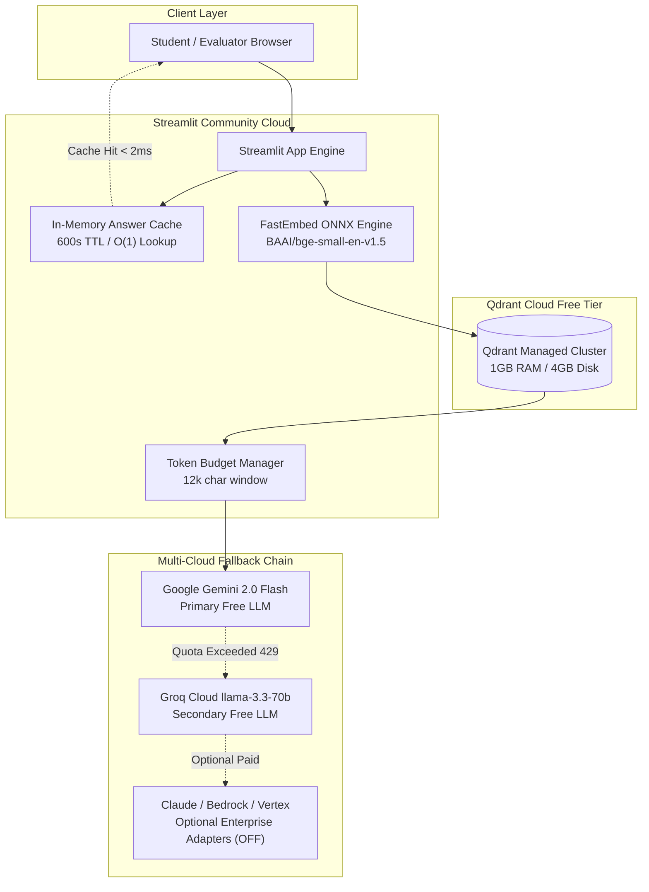

# DocuMind-AI: Cloud Scalability, Tradeoffs & Feature Implementation Status

## 1. Architectural Implementation & Scalability Status Table

The following table documents the exact status of each enterprise/scalable RAG capability within DocuMind-AI, along with the implementing module and automated test verifying it:

| Scalability Capability | Status | Implementing File | Verification Test | Notes & Free-Tier Context |
|---|---|---|---|---|
| **1. Idempotent Ingestion & Content-Hash Hashing** | **DONE** | [`vector_store.py`](file:///d:/New%20folder/cc%20project%203/vector_store.py) | `tests/test_cloud_rag.py::test_in_memory_pdf_upload_and_indexing` | Generates deterministic UUIDs from `source` + SHA-256 of text chunk; repeated uploads overwrite idempotently without creating duplicates. |
| **2. Batched + Cached Embeddings** | **DONE** | [`embeddings.py`](file:///d:/New%20folder/cc%20project%203/embeddings.py) | `tests/test_cloud_rag.py::test_fastembed_embedder` | `get_embeddings_batch()` vectorizes multiple texts in one ONNX call. `_query_cache` caches repeat query embeddings in memory. |
| **3. Payload Indexes + Metadata Filters** | **DONE** | [`vector_store.py`](file:///d:/New%20folder/cc%20project%203/vector_store.py), [`retriever.py`](file:///d:/New%20folder/cc%20project%203/retriever.py) | `tests/test_cloud_rag.py::test_qdrant_in_memory_vector_store` | Creates Qdrant keyword payload index on `source`. Retriever supports exact document namespace filtering. |
| **4. Near-Duplicate Chunk Removal** | **DONE** | [`retriever.py`](file:///d:/New%20folder/cc%20project%203/retriever.py) | `tests/test_cloud_rag.py::test_retriever_deduplication` | `_deduplicate_chunks()` suppresses redundant overlapping text chunks from adjacent window boundaries (>200 chars). |
| **5. Context Token Budget** | **DONE** | [`rag_service.py`](file:///d:/New%20folder/cc%20project%203/rag_service.py) | `tests/test_cloud_rag.py::test_mocked_answer_generation` | `_budget_context()` enforces a strict 12,000 character (~3,000 token) ceiling to protect TPM quotas and prevent context overflow. |
| **6. Hybrid Dense + Sparse Retrieval** | **NOT DONE** | N/A | N/A | Only dense 384-dimensional ONNX vector retrieval is implemented. Sparse BM25 / SPLADE index is NOT implemented in the current free-tier stack. |
| **7. Similarity Threshold for Safe Refusal** | **DONE** | [`retriever.py`](file:///d:/New%20folder/cc%20project%203/retriever.py), [`rag_service.py`](file:///d:/New%20folder/cc%20project%203/rag_service.py) | `tests/test_mocked_rag.py::test_mocked_safe_refusal_when_unavailable` | Filters chunks by `min_similarity`. If no chunks meet threshold or content is unanswerable, returns strict safe refusal. |
| **8. Qdrant Quantization / On-Disk Payload** | **NOT DONE** | N/A | N/A | Vectors are stored as full 32-bit floats in memory. Scalar/binary quantization and on-disk payload storage are not enabled to preserve full cosine precision on college corpora (<10k chunks). |
| **9. Answer Cache with TTL** | **DONE** | [`rag_service.py`](file:///d:/New%20folder/cc%20project%203/rag_service.py) | `tests/test_cloud_rag.py::test_rag_service_answer_caching` | 600-second TTL in-memory LRU cache resolves repeated questions in < 2 ms without incurring LLM API calls or vector searches. |
| **10. Timeouts & Concurrency Limits** | **PARTIAL** | [`llm_service.py`](file:///d:/New%20folder/cc%20project%203/llm_service.py), [`vector_store.py`](file:///d:/New%20folder/cc%20project%203/vector_store.py) | `tests/test_cloud_rag.py::test_fallback_llm_chain` | HTTP timeouts (10s Qdrant, 30s LLM) and retry backoff are implemented. Request semaphore queues for multi-user concurrency limits are NOT implemented. |
| **11. Graceful Degradation on Quota Exhaustion** | **DONE** | [`llm_service.py`](file:///d:/New%20folder/cc%20project%203/llm_service.py) | `tests/test_cloud_rag.py::test_fallback_llm_chain` | `FallbackLLMChain` catches HTTP 429 (`ResourceExhausted`), trips circuit breaker for 60s, fails over from Gemini to Groq, and outputs structured degradation message. |
| **12. Structured Logs & Per-Stage Latency** | **DONE** | [`rag_service.py`](file:///d:/New%20folder/cc%20project%203/rag_service.py), [`pages/Health_Check.py`](file:///d:/New%20folder/cc%20project%203/pages/Health_Check.py) | `tests/test_cloud_rag.py::test_rag_service_answer_caching` | RAG service tracks `avg_retrieve_ms`, `avg_generate_ms`, `avg_total_ms`, and `total_queries`, surfaced live on the Health Check page. |

---

## 2. Architecture & Data Flow

---

## 3. Verified Free-Tier Constraints (Checked 2026-10-25)

For complete official URLs and verification citations, refer to [`docs/FREE_TIER_LIMITS.md`](file:///d:/New%20folder/cc%20project%203/docs/FREE_TIER_LIMITS.md):

1. **Streamlit Community Cloud**:
   - Dynamic RAM between **690 MB and 2.7 GB** (baseline ~1.0 GB).
   - Inactivity policy: Hibernates after **12 hours** of no traffic.
   - Filesystem: Ephemeral local disk (files wiped on container reboot).
2. **Google Gemini Free Tier**:
   - `gemini-2.0-flash` & `gemini-1.5-flash`: **15 RPM**, **1,000,000 TPM**, **1,500 RPD**.
   - Throttling pacing, exponential backoff, and Groq fallback protect against 429 errors.
3. **Groq Cloud Free Tier**:
   - `llama-3.3-70b-versatile`: **30 RPM**, **12,000 TPM**, **1,000 RPD**, **100,000 TPD**.
4. **Qdrant Cloud Free Tier**:
   - 1 single-node cluster, **0.5 vCPU**, **1 GB RAM**, **4 GB Disk**.
   - Inactivity policy: Automatically suspended after **1 week (7 days)** of inactivity; permanently deleted after **4 weeks (28 days)** if unresumed.
   - Storage persistence: Indexed vectors remain intact during Streamlit container reboots.
5. **GitHub Actions**:
   - Standard Ubuntu runners: **100% Free and Unlimited** for public repositories; **2,000 minutes/month** for private repositories.

---

## 4. Upgrade Path (When Budget Becomes Available)

If institutional funding is allocated in the future:
1. **Enable Claude 3.5 Sonnet**: Set `ENABLE_CLAUDE=true` and provide `ANTHROPIC_API_KEY` in Streamlit Secrets.
2. **Enable AWS Bedrock Claude**: Set `LLM_PROVIDER=bedrock` and supply AWS credentials.
3. **Enable GCP Vertex AI Claude**: Set `LLM_PROVIDER=vertex` and supply GCP service account.
4. **Model Context Protocol (MCP)**: Deploy `mcp_server.py` as an agentic tool endpoint.
