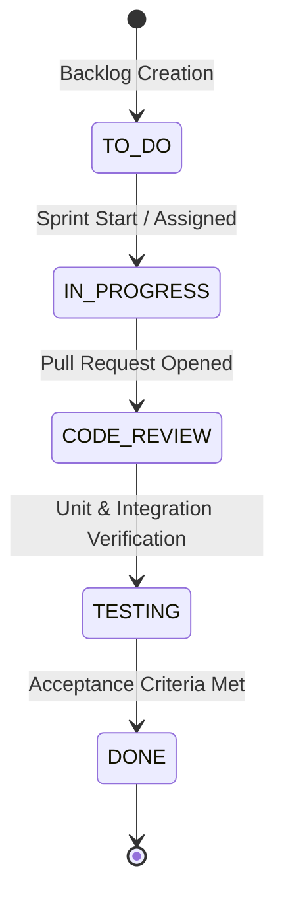

# Jira Scrum Project Setup Guide — College RAG Assistant

This guide provides instructions for setting up, configuring, and tracking the **College RAG Assistant** project using Atlassian Jira Cloud (Free Plan, up to 10 users).

---

## 1. Project Profile & Scrum Parameters

* **Platform:** Atlassian Jira Cloud (Free Tier)
* **Project Template:** Scrum Software Development
* **Project Name:** `College RAG Assistant`
* **Project Key:** `RAG`
* **Project Lead:** College Student / Development Lead
* **Sprint Cadence:** 2-Week Sprints (4 Sprints total)
* **Story Estimation:** Story Points (Fibonacci: 1, 2, 3, 5, 8, 13)
* **Default Issue Status for Imported Items:** `TO DO`

---

## 2. Agile Workflow Definition

The project follows a standard 5-stage software delivery workflow:



1. **TO DO**: Backlog items selected and estimated for the active sprint.
2. **IN PROGRESS**: Active development on feature branch (`cloud-scalable-rag`).
3. **CODE REVIEW**: Peer review and automated secret scanning.
4. **TESTING**: Execution of automated unit tests, heuristic evaluation, and safe refusal verification.
5. **DONE**: Code merged, verified passing 100% tests, and acceptance criteria fulfilled.

---

## 3. Epics Structure (6 Epics)

| Epic Key | Epic Summary | Total SP | Focus Area |
|---|---|---|---|
| **EPIC-1** | Document Ingestion & Extraction | 13 SP | In-memory PyPDF loader, corruption guards, metadata parsing |
| **EPIC-2** | Semantic Chunking & Vector Indexing | 18 SP | 500-char window, 100 overlap, whitespace normalization |
| **EPIC-3** | Cloud-Native Embedding & Vector Storage | 21 SP | FastEmbed ONNX 384d, Qdrant Cloud persistent cluster |
| **EPIC-4** | LLM Integration, Fallback & Grounded Generation | 21 SP | Gemini 2.0 Flash, Groq hot-standby, circuit breaker, anti-hallucination |
| **EPIC-5** | Testing, Safe Refusal & Benchmark Evaluation | 18 SP | 50-question benchmark dataset, latency percentiles, rubric scoring |
| **EPIC-6** | Cloud Deployment, CI/CD & Security | 18 SP | Streamlit Cloud deployment, GitHub Actions CI, secret scanning |

---

## 4. Step-by-Step Backlog Import via CSV

1. Navigate to your Jira Cloud workspace: `https://your-domain.atlassian.net`.
2. Click the gear icon (**Settings**) in the top right -> **System** -> **External System Import**.
3. Select **CSV** import option.
4. Upload `jira_management/jira_import.csv` from this repository.
5. In the **Map Fields** screen, configure the following mappings:
   * `Issue Type` -> **Issue Type**
   * `Issue Key` -> **Issue ID**
   * `Summary` -> **Summary**
   * `Description` -> **Description**
   * `Epic Name` -> **Epic Link / Parent**
   * `Story Points` -> **Story Points**
   * `Priority` -> **Priority**
   * `Status` -> **Status** *(Defaults to `TO DO`)*
   * `Sprint` -> **Sprint**
   * `Acceptance Criteria` -> **Environment / Acceptance Criteria**
6. Click **Begin Import**. All 25 user stories across 6 Epics will populate the project backlog.

---

## 5. Sprint Execution Plan

* **Sprint 1 (Weeks 1–2): Foundation & Ingestion**
  * Focus: EPIC-1 and EPIC-2 (PDF loader, chunking, test dataset creation).
* **Sprint 2 (Weeks 3–4): Cloud Embeddings & Vector Storage**
  * Focus: EPIC-3 (FastEmbed ONNX integration, Qdrant Cloud persistence).
* **Sprint 3 (Weeks 5–6): LLM Reasoning & Fallback Chains**
  * Focus: EPIC-4 (Google Gemini 2.0 Flash, Groq fallback, safe refusal).
* **Sprint 4 (Weeks 7–8): Benchmarking, CI/CD & Viva Demo**
  * Focus: EPIC-5 and EPIC-6 (50-question evaluation, latency percentiles, deployment checklist).

---

## 6. Screenshots & Board Artifacts

```
[SCREENSHOT 1: Jira Scrum Board - Active Sprint Columns View]
(Path: docs/screenshots/jira_board_active_sprint.png)

[SCREENSHOT 2: Jira Backlog & Epics Panel]
(Path: docs/screenshots/jira_backlog_epics.png)

[SCREENSHOT 3: Jira Sprint Burndown Chart]
(Path: docs/screenshots/jira_burndown_chart.png)
```
